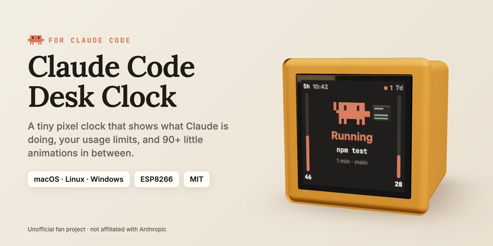

# Claude Code Desk Clock

**English** · [Українська](README.uk.md)

A tiny desk clock that shows what [Claude Code](https://claude.com/claude-code) is doing on your computer:
working, thinking, waiting for you, done. It also shows your 5-hour and 7-day usage limits. Between tasks a
pixel mascot keeps you company with 90+ little animations.

It runs on a cheap ESP8266 "smart weather clock" from AliExpress. You don't need to solder or compile anything.

<p align="center">
  
</p>

https://github.com/user-attachments/assets/70d152fb-0dde-48c6-8b8d-6f2c64f66179

> Unofficial fan project. Not affiliated with, endorsed by or supported by Anthropic.
> "Claude" and "Claude Code" are trademarks of Anthropic, PBC.

## What it shows

- **What Claude is doing right now**: Bash, editing, reading, searching, sub-agents, a permission request,
  "your turn", an error or done. It also shows the file or command and the project.
- **Several sessions at once**, from one or more computers.
- **Usage limits**: two vertical gauges (5 h and 7 d). From 70% up, each gauge also shows the time until reset
  and a pace mark.
- **Time and date** (synced over the internet), and a calm screen at night.
- **Mascot animations**: daily scenes, weather and time-of-day events, holidays, rare surprises,
  and a Santa hat from Dec 25 to Jan 7.

The clock speaks English (default) or Ukrainian: pick it on the Wi-Fi setup page or during `claude-clock setup`. The holiday calendar is Ukrainian, with English captions.

## What you need

- **The clock.** Search AliExpress for "smart weather clock ESP8266" or "SmallTV". It is a cube about 5 cm wide with a
  1.54" 240×240 colour screen. It was tested with the version whose stock firmware is called **"SD PRO"**
  ([details](docs/HARDWARE.md)).
- **A computer** running Claude Code: macOS, Linux or Windows.
- **Wi-Fi.** The clock and the computer must be on the same home network (2.4 GHz).

## Install (about 5 minutes)

### 1. Put the firmware on the clock

1. Set the clock up with its own instructions so it joins your Wi-Fi, then open its IP address in a browser.
2. Download `SDP_claude-clock-vX.Y.Z.bin` from the
   [latest release](https://github.com/BolgarMaxym97/claude-code-desk-clock/releases/latest).
   Keep the file name: the stock update page only accepts names that start with `SDP`.
3. On the clock's web page, open the firmware update (OTA) section, choose the file and start the update.
   After about a minute the clock restarts with the new firmware.

If the upload is interrupted, the old firmware stays in place. Just try again.

### 2. Connect the clock to Wi-Fi

The clock shows a QR code and a network name, **Claude-Clock**, with a password.

1. Scan the QR code with your phone camera and join the network.
2. The setup page opens. If it doesn't, open `http://192.168.4.1`.
3. Pick your Wi-Fi, type the password and wait for ✓.

### 3. Connect your computer

**macOS / Linux**, in Terminal:

```sh
curl -fsSL https://raw.githubusercontent.com/BolgarMaxym97/claude-code-desk-clock/main/install/install.sh | sh
```

**Windows**, in PowerShell:

```powershell
irm https://raw.githubusercontent.com/BolgarMaxym97/claude-code-desk-clock/main/install/install.ps1 | iex
```

The installer downloads the small `claude-clock` program and finds the clock on your network. The clock then shows a
6-character code: type it in, then pick the clock language (Enter = English). Confirm the change to Claude Code settings (a backup is made first), then restart
Claude Code. That's it.

To add another computer, run the same line there. Each computer gets its own code.

## Everyday commands

| Command | What it does |
|---|---|
| `claude-clock status` | Clock address, firmware version, what it shows now |
| `claude-clock update` | Install the newest firmware from GitHub over Wi-Fi |
| `claude-clock config --lang uk` | Clock language: `en` (default) or `uk` |
| `claude-clock config --birthday 11-20` | Show a birthday animation on that day (`off` to remove) |
| `claude-clock config --tz auto` | Send this computer's timezone to the clock (done at setup) |
| `claude-clock setup` | Pair again (new clock, new IP, new computer) |
| `claude-clock uninstall` | Remove the hooks and restore your own statusline |

## Moving to another Wi-Fi

If the clock cannot reach its network for about 2–3 minutes, it shows the QR code again. Repeat step 2.

## Troubleshooting

- **The installer can't find the clock.** Check that the computer and the clock are on the same network. Some
  "guest" networks block devices from seeing each other. You can type the IP address shown in your router's device
  list (the name is `claude-clock`), or run `claude-clock setup --ip 192.168.1.50`.
- **"Too many wrong codes".** Unplug the clock, plug it back in and run `claude-clock setup` again.
- **The clock stopped reacting after a router restart.** Its IP address probably changed. The program looks the clock
  up again by name. If that doesn't help, run `claude-clock setup`. Giving the clock a fixed IP address in your
  router settings avoids this.
- **The time is wrong.** Run `claude-clock config --tz auto`.
- **The clock is stuck on "Connecting".** Wait about 3 minutes. It will open the Wi-Fi setup by itself.

## Privacy and security

- Everything stays on your local network. There is no cloud and no account. The clock gets the time from
  `pool.ntp.org`. `claude-clock update` downloads firmware from GitHub Releases and checks it against its sha256 checksum.
- **What the computer sends to the clock**:
  - the event type (for example "tool started");
  - the tool name;
  - the project folder name;
  - the git branch;
  - **the first 22 characters** of the current command, file name, search, or your prompt;
  - for a finished terminal command, only which of these it did: tests, commit, push, install, docker
    (the command itself is checked on your computer).

  Nothing else from Claude Code is read or stored.
- This goes over plain HTTP on your home network and is protected by a per-clock token. The clock generates the token
  itself and gives it only to a computer that types the code shown on its screen. Don't use the clock on networks
  you don't trust.

## Development

See [docs/DEVELOPMENT.md](docs/DEVELOPMENT.md): building the firmware, tests, the clock's HTTP API and how
releases are made.

## License

[MIT](LICENSE). Third-party fonts and libraries are listed in [THIRD_PARTY_NOTICES.md](THIRD_PARTY_NOTICES.md).
