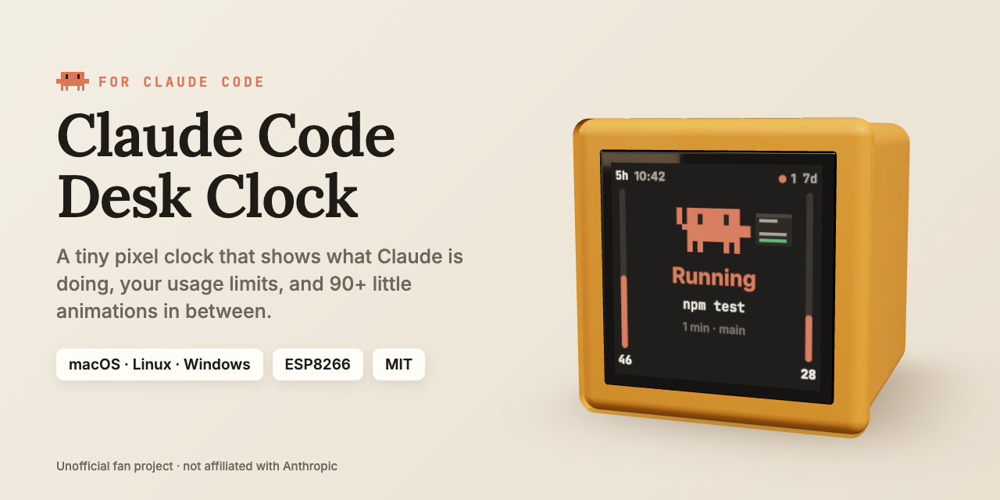

# Claude Code Desk Clock

[English](README.md) · **Українська**

Маленький настільний годинник, який показує, що зараз робить [Claude Code](https://claude.com/claude-code) на твоєму
комп'ютері: працює, думає, чекає на тебе, завершив. Також показує ліміти використання за 5 годин і 7 днів. Між задачами
компанію складає піксельний маскот із понад 90 анімаціями.

Працює на дешевому годиннику з ESP8266 («smart weather clock») з AliExpress. Паяти чи компілювати нічого не треба.

<p align="center">
  
</p>

https://github.com/user-attachments/assets/215340ce-2eeb-45b8-a00e-d6261b67464f

> Неофіційний фанатський проєкт. Не пов'язаний з Anthropic і не підтримується нею.
> «Claude» і «Claude Code» є торговими марками Anthropic, PBC.

## Що показує

- **Що Claude робить просто зараз**: Bash, редагування, читання, пошук, субагенти, запит дозволу,
  помилку чи завершення. Також видно файл чи команду, назву проєкту і наскільки заповнений **контекст** сесії
  (жовтий від 80 %, «скоро стискання» від 90 %). Якщо запит дозволу висить 5 хвилин, він починає пульсувати.
- **Кілька сесій одночасно**, з одного або кількох комп'ютерів.
- **Ліміти**: дві вертикальні шкали (5 год і 7 днів). Від 70 % під кожною шкалою з'являється час до скидання і мітка
  темпу.
- **Час і дата** (синхронізуються через інтернет), а вночі спокійний екран.
- **Анімації маскота**: щоденні сценки, події за погодою й часом доби, свята, рідкісні сюрпризи, а з 25 грудня
  по 7 січня маскот у шапці Санти.
- **Інфо-рядок під маскотом** (за бажанням), змінюється кожні 5 с: **погода** (власний безкоштовний ключ OpenWeather, з іконкою)
  і **сьогодні з Claude**: скільки часу Claude працював, скільки відповідей і комітів. Якщо підключити календар, додається
  **найближча зустріч**; за 10 хвилин до неї рядок синіє і закріплюється. В Україні **повітряна тривога** для твого регіону
  займає рядок червоним і вночі будить годинник (тьмяно). Кожен пункт можна вимкнути. Рядок погоди підказує, коли
  почнеться дощ чи сніг («дощ о 18:00»), а в понеділок показує підсумок **минулого тижня з Claude**.
- **Твої повідомлення**: `claude-clock say "Збірка готова"` показує на годиннику зелену картку, зручно в кінці скрипта.
- **Сторінка налаштувань** на самому годиннику: відкрий `http://claude-clock.local/` (або IP-адресу з `claude-clock status`)
  у браузері в тій самій мережі й введи код з екрана годинника.
  Мова, циферблат (класичний, мінімальний, піксельний, сегментний, перекидний, термінал, двійковий), яскравість, нічні
  години, погода, тривоги й анімації: познач обрані й крути тільки їх, вимкни групи (свята, події…), обери, наскільки
  жвавий маскот, зіграй будь-яку зараз або тримай одну хвилини, години чи завжди, або скинь усе до заводських.

Годинник говорить англійською (за замовчуванням) або українською: мову обирають на сторінці налаштування Wi‑Fi або під час `claude-clock setup`. Календар свят український, з англійськими підписами в англійському режимі.

## Що потрібно

- **Годинник.** На AliExpress шукай «smart weather clock ESP8266» або «SmallTV». Це кубик близько 5 см з кольоровим
  екраном 1,54″ 240×240. Перевірено на версії, де заводська прошивка називається **«SD PRO»**
  ([подробиці](docs/HARDWARE.md)).
- **Комп'ютер** із Claude Code: macOS, Linux або Windows.
- **Wi‑Fi.** Годинник і комп'ютер мають бути в одній домашній мережі (2,4 ГГц).

## Встановлення (≈5 хвилин)

### 1. Прошивка годинника

1. Налаштуй годинник за його інструкцією, щоб він підключився до твого Wi‑Fi. Потім відкрий його IP-адресу в браузері.
2. Завантаж `SDP_claude-clock-vX.Y.Z.bin` з
   [останнього релізу](https://github.com/BolgarMaxym97/claude-code-desk-clock/releases/latest).
   Не перейменовуй файл: заводська сторінка оновлення приймає лише назви, що починаються з `SDP`.
3. На сторінці годинника відкрий розділ оновлення прошивки (OTA), обери файл і запусти оновлення. Приблизно за хвилину
   годинник перезапуститься вже з новою прошивкою.

Якщо завантаження перерветься, лишиться стара прошивка. Просто спробуй ще раз.

### 2. Підключення годинника до Wi‑Fi

Годинник покаже QR-код і назву мережі **Claude-Clock** з паролем.

1. Скануй QR-код камерою телефона і підключись до мережі.
2. Відкриється сторінка налаштування. Якщо ні, відкрий `http://192.168.4.1`.
3. Обери свою мережу Wi‑Fi, введи пароль і дочекайся ✓.

### 3. Підключення комп'ютера

**macOS / Linux**, у Терміналі:

```sh
curl -fsSL https://raw.githubusercontent.com/BolgarMaxym97/claude-code-desk-clock/main/install/install.sh | sh
```

**Windows**, у PowerShell:

```powershell
irm https://raw.githubusercontent.com/BolgarMaxym97/claude-code-desk-clock/main/install/install.ps1 | iex
```

Інсталятор завантажить невелику програму `claude-clock` і знайде годинник у мережі. Годинник покаже 6-значний код:
введи його, потім обери мову годинника (Enter = English). Далі необов'язкові питання: ключ OpenWeather і місто для
погоди, а якщо на комп'ютері український часовий пояс, то й регіон для тривог. Enter пропускає кожне. Підтверди зміну налаштувань Claude Code (спершу робиться резервна копія) і перезапусти Claude Code.
Готово.

Щоб додати ще один комп'ютер, запусти на ньому той самий рядок. Кожен комп'ютер отримує свій код.

## Команди на кожен день

| Команда | Що робить |
|---|---|
| `claude-clock status` | Адреса годинника, версія прошивки, що він зараз показує |
| `claude-clock update` | Встановити найновішу прошивку з GitHub через Wi‑Fi |
| `claude-clock config --lang uk` | Мова годинника: `en` (за замовчуванням) або `uk` |
| `claude-clock config --birthday 11-20` | Святкова анімація в цей день (`off`, щоб прибрати) |
| `claude-clock config --tz auto` | Передати годиннику часовий пояс цього комп'ютера (робиться при setup) |
| `claude-clock config --weather-key <ключ>` | Погода на годиннику: безкоштовний ключ з [openweathermap.org](https://openweathermap.org/api) (`off`, щоб прибрати). Новий ключ починає працювати протягом 2 годин |
| `claude-clock config --city Kyiv` | Місце для погоди: назва міста або `50.45,30.52` |
| `claude-clock config --calendar <адреса>` | Найближча зустріч на годиннику: таємна адреса календаря у форматі iCal (Google Calendar: налаштування календаря, «Integrate calendar»; Outlook: «Publish a calendar», посилання ICS). `off`, щоб прибрати |
| `claude-clock config --calendar-email you@work.com` | Ховати зустрічі, від яких ти відмовився |
| `claude-clock config --calendar-titles off` | Показувати «Зустріч» замість назв |
| `claude-clock config --alerts "м. Київ"` | Повітряні тривоги для регіону; `list` показує всі регіони, `off` вимикає тривоги |
| `claude-clock config --night 23-7` | Нічні години (нічний екран); `off`: ніколи не засинати |
| `claude-clock config --brightness 80/20` | Яскравість вдень / вночі, % |
| `claude-clock config --face pixel` | Циферблат: `classic`, `minimal`, `pixel`, `segment`, `flip`, `terminal` або `binary` |
| `claude-clock config --alerts-token <токен>` | Рівні тривоги з [alerts.in.ua](https://alerts.in.ua/api-request): дрони чи ракети, загроза (жовтий рівень), тривога в частині області. Видно, поки на цьому комп'ютері працює Claude Code (сервісу потрібен HTTPS, якого годинник не тягне); `off`, щоб прибрати |
| `claude-clock scene list` | Усі анімації; `scene guitar --for 2h` (або `--for always`) тримає одну, `scene guitar --once` грає її зараз, `scene off` повертає випадкові |
| `claude-clock say "Збірка готова" "api · 4 хв" --for 5m` | Повідомлення на годиннику (`say off` прибирає) |
| `claude-clock setup` | Підключити заново (новий годинник, нова IP-адреса, новий комп'ютер) |
| `claude-clock uninstall` | Прибрати хуки і повернути твій statusline |

## Перехід на іншу мережу Wi‑Fi

Якщо годинник 2–3 хвилини не може підключитися до своєї мережі, він знову покаже QR-код. Повтори крок 2.

## Якщо щось не так

- **Інсталятор не знаходить годинник.** Перевір, що комп'ютер і годинник в одній мережі. Деякі «гостьові» мережі не
  дають пристроям бачити один одного. Можна ввести IP-адресу зі списку пристроїв на роутері (ім'я `claude-clock`)
  або запустити `claude-clock setup --ip 192.168.1.50`.
- **«Too many wrong codes».** Вийми годинник з розетки, увімкни знову і запусти `claude-clock setup`.
- **Після перезапуску роутера годинник перестав реагувати.** Найімовірніше, змінилась його IP-адреса. Програма сама
  шукає годинник за іменем. Якщо не допомогло, запусти `claude-clock setup`. Щоб цього уникнути, закріпи за годинником
  постійну IP-адресу в налаштуваннях роутера.
- **Не відкривається `claude-clock.local`.** Safari на Mac та iPhone його знаходить. Chrome може не знайти, поки
  увімкнено «Безпечний DNS», а деякі Android-телефони не підтримують імена `.local`. Відкривай IP-адресу з
  `claude-clock status`.
- **Неправильний час.** Запусти `claude-clock config --tz auto`.
- **Годинник довго показує «Підключаюсь».** Зачекай близько 3 хвилин, він сам відкриє налаштування Wi‑Fi.
- **Сіре «?» після дати.** Джерело тривог не відповідає понад 5 хвилин, тож годинник не знає, чи є тривога.
  Поки воно не зникне, орієнтуйся на офіційні джерела.
- **Сіре «safe» після дати.** Годинник тричі поспіль перезапустився після збою і перестав завантажувати погоду й
  тривоги. Вимкни його з розетки на кілька секунд або запусти `claude-clock update`. Подробиці в рядку «Health»
  у `claude-clock status`.
- **Мережа блокує інтернет-час (NTP).** Годинник візьме час з комп'ютера з першою подією Claude Code.

## Приватність і безпека

- Усе лишається у твоїй локальній мережі: без хмари й акаунтів. Годинник бере час з `pool.ntp.org`.
  `claude-clock update` завантажує прошивку з GitHub Releases і звіряє її контрольну суму sha256.
- **Що комп'ютер надсилає годиннику**:
  - тип події (наприклад, «інструмент запущено»);
  - назву інструмента;
  - назву папки проєкту;
  - гілку git;
  - **перші 22 символи** поточної команди, назви файлу, пошуку або твого запиту;
  - для завершеної команди терміналу лише мітки, що в ній було: тести, коміт, пуш, встановлення, Docker
    (саму команду перевіряє твій комп’ютер).

  Нічого іншого з Claude Code не читається і не зберігається.
- **Календар**: таємна адреса лишається в конфігу `claude-clock` на твоєму комп'ютері й ніколи не потрапляє на годинник.
  Поки працює Claude Code, `claude-clock` раз на 5 хвилин читає календар і надсилає годиннику зустрічі на 12 годин
  уперед: початок, кінець і назву (назви можна вимкнути).
- **Погоду й тривоги** годинник бере сам, звичайним HTTP (чип не вміє TLS): `api.openweathermap.org` з твоїм ключем
  і координатами, `ubilling.net.ua/aerialalerts` без жодних твоїх даних. Дані про тривоги довідкові: орієнтуйся
  на офіційні джерела. Ключ OpenWeather зберігається на годиннику і в конфігу `claude-clock`, `claude-clock status`
  його ніколи не показує.
- Це передається звичайним HTTP у домашній мережі й захищено токеном конкретного годинника. Токен годинник створює
  сам і віддає лише комп'ютеру, на якому ввели код з його екрана. Не використовуй годинник у мережах, яким
  не довіряєш.

## Розробка

Див. [docs/DEVELOPMENT.md](docs/DEVELOPMENT.md) (англійською): збірка прошивки, тести, HTTP API годинника, як робляться
релізи.

## Ліцензія

[MIT](LICENSE). Сторонні шрифти й бібліотеки перелічені в [THIRD_PARTY_NOTICES.md](THIRD_PARTY_NOTICES.md).
